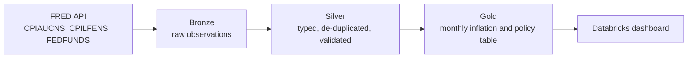

# Inflation, Core Prices & Fed Policy: A Databricks Medallion Pipeline

An end-to-end data pipeline that extracts U.S. inflation and federal funds rate data from the FRED API, lands it in Databricks, and refines it through a **bronze / silver / gold** medallion architecture to answer one question: how restrictive has monetary policy been relative to inflation?


---

## Business Question

**How restrictive has Federal Reserve policy been relative to inflation since 2019, and is the inflation it is responding to driven by underlying core prices or by volatile headline components?**

This breaks into three sub-questions:

1. How has the **real federal funds rate** (policy rate minus inflation) moved since 2019?
2. How large is the gap between **headline and core inflation**, and when did it peak?
3. How quickly did the policy rate respond as inflation rose and then cooled?

## Why It Matters

The federal funds rate is the Fed's main policy tool, but a rate level means little on its own. What matters for borrowers, savers, and banks is the rate *relative to inflation*. A positive real rate means policy is restrictive and savers are earning more than prices are rising. A negative real rate means the opposite, which favors borrowers. Comparing headline inflation with core inflation (which excludes food and energy) also shows whether price pressure is broad and persistent or driven by volatile items.

## Key Findings

- The real federal funds rate was negative in **44 of the 92 months** with a calculable real rate between January 2019 and September 2026 (October 2025 has no CPI data), and returned to positive territory in **May 2023**.
- Headline inflation peaked at **9.06%** in **June 2022**, compared with **5.92%** for core inflation.
- The headline-to-core gap was widest at **3.14 percentage points** in **June 2022**.
- The policy rate reached **5.33%** in **August 2023**, about **14 months** after headline inflation peaked.

## Dashboard

The Databricks AI/BI dashboard, titled **"Are Savers Keeping Up?"**, sits on top of the gold table. It shows counters for headline CPI, core CPI, and the federal funds rate (with the change versus the prior month), plus line charts for headline vs. core CPI, the federal funds rate, and the real rate proxy. The exported dashboard file is in `dashboard/`.

---

## Architecture



## Data Sources

All data comes from the Federal Reserve Bank of St. Louis (FRED) API.

| FRED series | Description | Frequency | Units |
|---|---|---|---|
| `CPIAUCNS` | CPI for All Urban Consumers: All Items (headline), not seasonally adjusted | Monthly | Index, 1982-84 = 100 |
| `CPILFENS` | CPI for All Urban Consumers: All Items Less Food and Energy (core), not seasonally adjusted | Monthly | Index, 1982-84 = 100 |
| `FEDFUNDS` | Federal funds effective rate, monthly average | Monthly | Percent |

## Pipeline Layers

| Layer | Table | What happens |
|---|---|---|
| Bronze | `fred_series_bz` | Raw API responses stored as strings (`series_id`, `date`, `value`) with an ingestion timestamp. Nothing is cleaned, so the source can always be traced. |
| Silver | `fact_economic_observations_sr` | Values converted to numbers (FRED's `.` for missing becomes null), dates typed, duplicates removed (latest ingest wins), data-quality expectations applied. One row per series per month. |
| Gold | `monthly_macro_agg_gd` | One row per month, with the three series pivoted side by side and the derived inflation and policy metrics calculated. |

## Data Quality

The silver layer uses Spark Declarative Pipeline **expectations** to validate data before it reaches gold.

| Expectation | What it checks | On failure |
|---|---|---|
| `[series_id]` | `[series_id is not null, so every row traces back to a FRED series]` | `[fail]` |

## Gold Table: Data Dictionary

| Column | Meaning | Calculation |
|---|---|---|
| `release_date` | First day of the month the data refers to | From FRED |
| `headline_cpi_index` | Headline CPI index level | From FRED (`CPIAUCNS`) |
| `core_cpi_index` | Core CPI index level (excludes food and energy) | From FRED (`CPILFENS`) |
| `fed_funds_rate_pct` | Effective federal funds rate, monthly average (%) | From FRED (`FEDFUNDS`) |
| `headline_inflation_yoy_pct` | Headline year-over-year inflation (%) | `(CPI_t / CPI_t-12 - 1) x 100` |
| `core_inflation_yoy_pct` | Core year-over-year inflation (%) | `(Core_t / Core_t-12 - 1) x 100` |
| `fed_funds_rate_change_mom` | Month-over-month change in the policy rate, in percentage points | `FFR_t - FFR_t-1` |
| `fed_funds_real_rate_proxy` | Real rate proxy, in percentage points | `fed_funds_rate_pct - headline_inflation_yoy_pct` |

## Design Decisions

- **Bronze stays raw.** All values are stored as strings with an ingestion timestamp, so schema or format surprises never break the load, and every number can be traced back to its API response.
- **Safe reruns.** Bronze appends each pull with an ingestion timestamp, and silver keeps the latest ingest per series and month, so rerunning the pipeline never creates duplicates downstream and adding a series never erases the others.
- **Year-over-year uses date joins, not row offsets.** Prior-year values are found with `add_months(observation_date, -12)` rather than `LAG(12)`, so a missing month produces a null in the right place instead of shifting every later row.
- **Not seasonally adjusted CPI.** BLS reports year-over-year inflation from non-seasonally-adjusted indexes, so using them lets the results reconcile to published BLS figures.
- **Credentials stay out of the code.** The FRED API key is read from a Databricks secret scope.
- **Known data gap.** BLS did not publish an October 2025 CPI index (data was not collected during the fall 2025 federal government shutdown). That month is kept as a null row, so year-over-year inflation for October 2025 is null, and October 2026 will be null too once it is published, because its prior-year base is missing. The real-rate proxy is null for those months. Nothing is filled in or interpolated, which is why the CPI lines on the dashboard show a break near the end of 2025.

## Limitations

- The real rate is a **simple ex-post measure**: it subtracts *past* 12-month inflation from the current policy rate. It does not use inflation expectations or an estimate of the neutral rate, so it is a rough gauge of policy stance, not a precise one.
- Headline and core CPI are U.S. city averages and do not reflect regional or household-level differences.
- Core inflation excludes food and energy by definition, so it can understate the inflation people feel day to day.
- The federal funds rate is a monthly average, so it can lag the Fed's actual policy decisions by part of a month. For example, a mid-month change such as the September 2026 rate increase is only partly reflected in that month's figure.

## How to Run

1. Create a free [FRED API key](https://fred.stlouisfed.org/docs/api/api_key.html) and store it in a Databricks secret scope.
2. Create a Spark Declarative Pipeline in your workspace and add the bronze, silver, and gold source files from `pipeline/`.
3. In the pipeline settings, set your catalog and target schema.
4. Run the pipeline. The bronze step pulls the FRED series on each run and appends the results; silver keeps only the latest ingest for each series and month, so reruns don't create duplicates downstream.
5. Import the `.lvdash.json` file from `dashboard/` into your workspace, then update the dataset queries to point at your own catalog and schema.

## Repository Structure

```
.
├── pipeline/
│   ├── 01_bronze_ingest
│   ├── 02_silver_clean
│   └── 03_gold_build
├── sql/            # dashboard dataset queries
├── dashboard/      # exported .lvdash.json
├── images/         # dashboard screenshots
└── README.md
```

## Tech Stack

Databricks (Spark Declarative Pipelines, Delta Lake, Unity Catalog, AI/BI dashboards) | Python (`requests`, `pandas`) | PySpark and SQL | FRED API

## Data Attribution

Data from the Federal Reserve Bank of St. Louis (FRED), sourced from the U.S. Bureau of Labor Statistics (CPI) and the Board of Governors of the Federal Reserve System (federal funds rate). This project is for educational and portfolio purposes and is not investment or economic advice.

---

*Built by William H. Robinson | [LinkedIn](https://www.linkedin.com/in/williamhrobins0n/)*